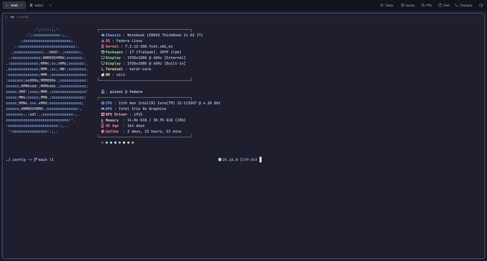
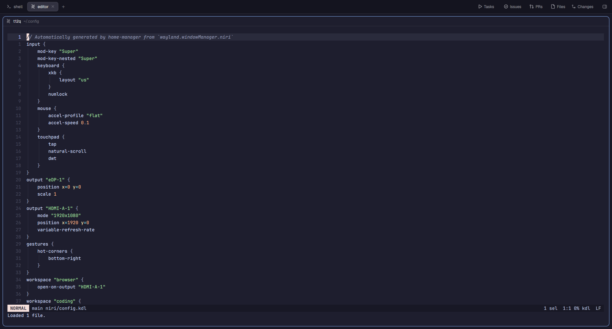

<div align="center">

# Dotfiles

**A Wayland desktop on Fedora: niri, Noctalia, Herdr and a Catppuccin-flavoured terminal stack.**



</div>

This is my live `~/.config`, versioned in place. Everything is whitelisted in
[`.gitignore`](.gitignore) (the file starts with `/*`), so only configs I chose
to track end up here; caches, browser profiles and tokens never do.

## The setup

| | |
|---|---|
| Compositor | [niri](https://github.com/niri-wm/niri), a scrollable-tiling Wayland compositor |
| Shell / bar / launcher | [Noctalia](https://github.com/noctalia-dev/noctalia) |
| Terminals and agents | [Herdr](https://herdr.dev), with `herdr-core` keeping terminals alive |
| Terminal emulator | Ghostty (a Kitty config is tracked too) |
| Shells | Nushell (Herdr's default) and Fish, with Starship |
| Editors | Zed and Helix |
| File manager / git | Yazi, lazygit |
| Theme | Catppuccin (Macchiato Mauve on Qt via Kvantum, Mocha surfaces in Herdr) |
| OS | Fedora Linux, on a ThinkBook 14 G2 laptop plus an external HDMI monitor |

<div align="center">

</div>

## Workspaces that follow the monitors

Six named workspaces, whatever monitors are plugged in:

| Workspace | With HDMI connected | Laptop alone |
|---|---|---|
| `browser` `coding` `herdr` `extra` | HDMI, positions 1 to 4 | Laptop, positions 1 to 4 |
| `social` `music` | Laptop, positions 1 and 2 | Laptop, positions 5 and 6 |

`Mod+1` to `Mod+6` always focus the same workspace by name, so muscle memory
survives unplugging the monitor. [`niri/scripts/workspace-owner.sh`](niri/scripts/workspace-owner.sh)
listens to niri's event stream and, whenever workspaces change, moves each one
to the right output and puts them back in order. It is idempotent: once
everything is in place, the events it causes change nothing.

Window rules open each app on its own workspace (browser, Zed, Herdr, Discord,
music player).

## Herdr

[Herdr](https://herdr.dev) is the terminal and coding-agent workspace. Its own
mods and layouts live in a separate repository,
[Piioni/herdr-dots](https://github.com/Piioni/herdr-dots). This repo only
tracks the small `herdr/` and `herdr-core/` config files.

## What is in here

| Path | What it configures |
|---|---|
| `niri/` | compositor config and helper scripts (workspace ownership, screen recording) |
| `noctalia/` | shell config (bar widgets, control center) |
| `ghostty/`, `kitty/`, `fish/`, `nushell/`, `starship.toml`, `zellij/` | terminal and shell |
| `yazi/`, `lazygit/`, `helix/`, `zed/`, `btop/`, `cava/`, `fastfetch/` | tools |
| `Kvantum/`, `qt6ct/`, `gtk-3.0/`, `gtk-4.0/`, `nwg-look/`, `xsettingsd/` | Qt and GTK theming |
| `herdr/`, `herdr-core/` | Herdr and its core |
| `agents/` | skills and output styles for coding agents |
| `mimeapps.list`, `user-dirs.dirs`, `git/ignore`, `gh/config.yml` | defaults and small tool configs |
| `pkglist.md` | curated package list |

### Previous setup

`hypr/`, `uwsm/`, `caelestia/`, `swaync/`, `fuzzel/`, `swayimg/` and `swappy/`
come from my earlier Hyprland and Caelestia desktop. They are still tracked,
but niri and Noctalia are what I run today. The original Hyprland dotfiles,
with their install script, live on the
[`hyprland-legacy`](https://github.com/Piioni/Dotfiles/tree/hyprland-legacy)
branch.

## Using it

There is no installer. Look at what you want and copy it:

```sh
git clone https://github.com/Piioni/Dotfiles
cp -r Dotfiles/niri Dotfiles/noctalia ~/.config/
```

Some files hardcode `/home/piioni` (for example the `record-region.sh` path in
the niri config and Herdr's default shell). Search for it before using a file
as is.

## Not tracked on purpose

Wallpapers and avatars (`noctalia/assets`), browser and app data, and anything
holding credentials such as `gh/hosts.yml`.
