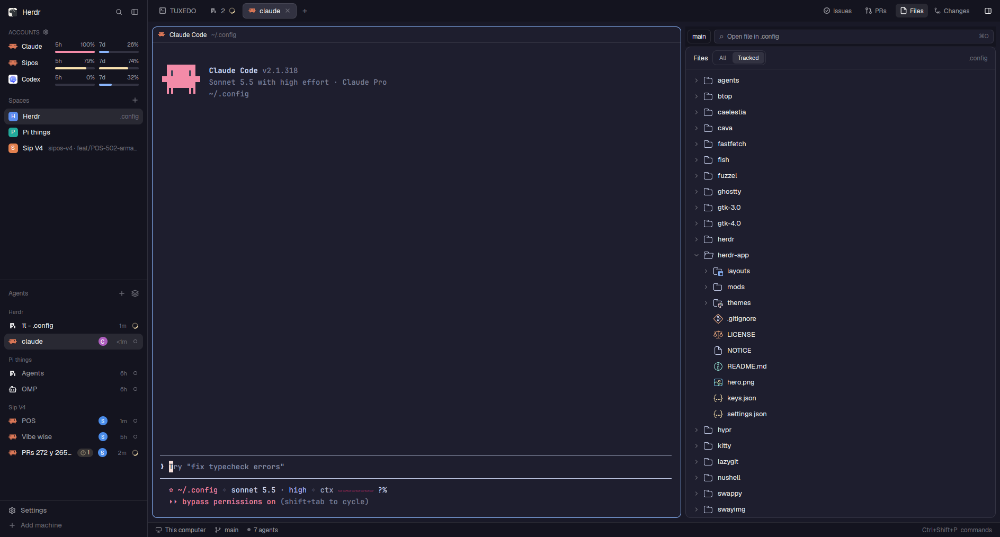
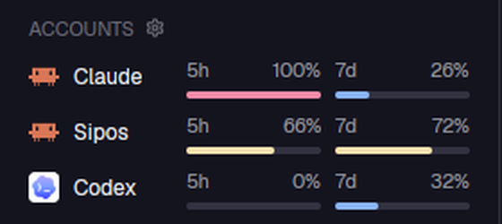
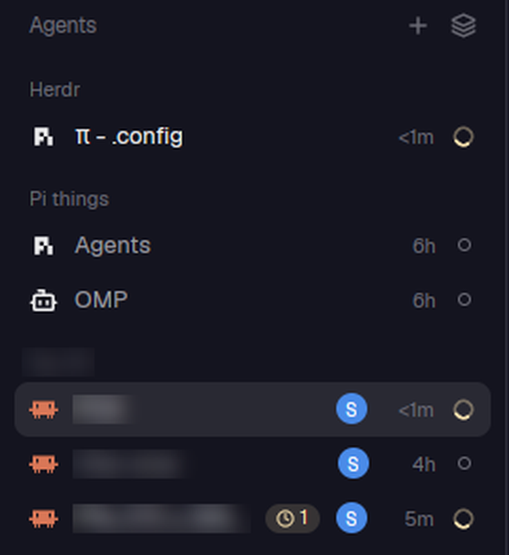
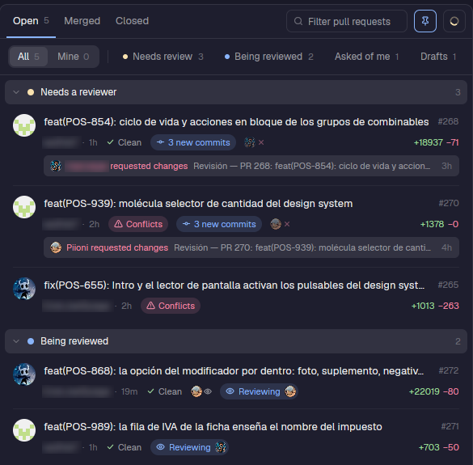
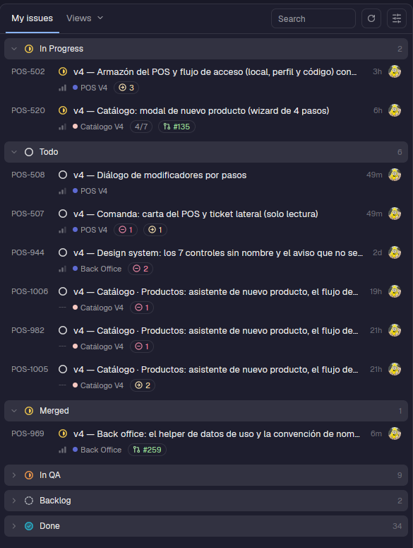
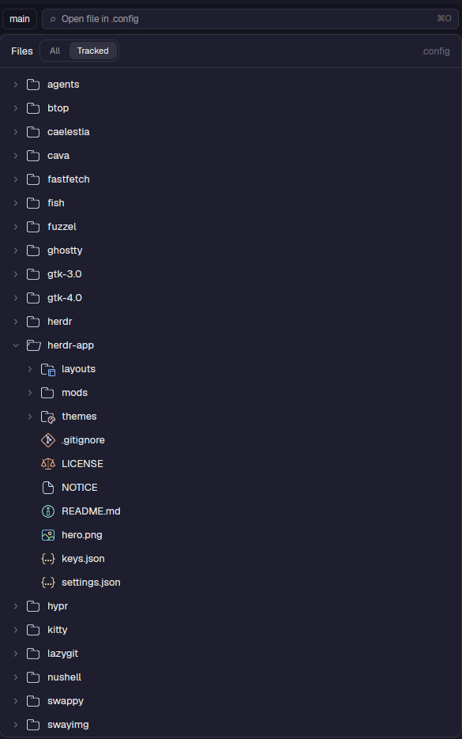
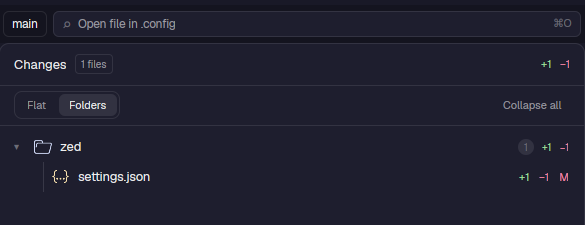
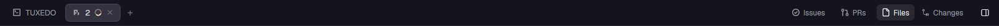

# herdr-dots

My configuration of the [Herdr](https://herdr.dev) desktop app: a layout and the mods behind it. Herdr's interface is
files (layouts, mods, keys, settings), so this folder *is* the app's look and behavior.



## Mods

| Mod | What it is | |
|---|---|---|
| [`relevo`](mods/relevo) | Accounts and their usage, launchers, handoff between accounts, the panel bar and Settings |  |
| [`relevo-agents`](mods/relevo-agents) | Herdr's Agents list + a launcher menu, an account circle and a background-work capsule |  |
| [`prs`](mods/prs) | GitHub pull requests: a panel and a full PR dialog |  |
| [`linear`](mods/linear) | Your Linear tickets as a panel |  |
| [`ion-files`](mods/ion-files) | File tree with file operations and Helix |  |
| [`ion-changes`](mods/ion-changes) | Uncommitted changes, Neovim diffs and a commit box |  |
| [`ion-tabs`](mods/ion-tabs) | The tab bar and the panel buttons |  |

Each mod has its own README with what it does, why it exists, what it needs and how to test it.

### Naming

- `ion-*`: clones of Herdr's own mods (`files`, `changes`, `tabs`), improved. Herdr rewrites its shipped mods on every
  start, so changes to them have to live in a clone with another name.
- `relevo`, `relevo-agents`: depend on the Relevo setup (accounts and launchers), and derive from
  [herdr-relevo](https://github.com/johnny4young/herdr-relevo).
- `prs`, `linear`: my own.

## Get it yourself

The easiest way is to let your agent do it, picking only what you want. Tell your agent to:

```text
Read ~/.config/herdr-app/AGENTS.md, then add the mods from https://github.com/Piioni/herdr-dots to my
Herdr app, asking me what I want. Go mod by mod: read its README, tell me what it is and how it works,
and ask whether I want it. Only add the ones I say yes to, and never replace my keys.json, settings.json
or layouts without asking.

Be careful with relevo and relevo-agents: they are built around one person's workflow (provider accounts,
launchers, and Claude/Pi/Codex profiles), so do not copy mods/relevo/config.js as it is. If I want them,
explain what accounts, launchers and profiles are, ask me which ones I have, and write a config for me.
The account circle and the background-work capsule need the Claude Code hook in mods/relevo/hooks: explain
what it does and ask before installing it.

prs needs the GitHub CLI (gh) logged in. linear needs a Linear API key in ~/.config/linear/token: ask me
to put it there myself, and never ask me to paste it in a command line. The ion-* mods are clones of Herdr's
own files, changes and tabs: tell me what each one changes before adding it. The piioni layout is
optional: ask me if I want to use it or only some of its pieces.
```

### What the mods need

| Need | For |
|---|---|
| `gh` ([GitHub CLI](https://cli.github.com/)), logged in | `prs` |
| Linear API key in `~/.config/linear/token` | `linear`, the Linear chip in `prs` |
| `hx` (Helix) | `ion-files` |
| `git` and `nvim` | `ion-changes` |
| Claude Code, and optionally its hook (`mods/relevo/hooks`) | account usage, the account circle, background work |
| Edit `mods/relevo/config.js` (or use Settings) | your accounts and launchers: the checked-in one is mine |

## What is versioned

Only what is mine; the `.gitignore` is an allow-list. Herdr's own files (shipped mods and layouts, icons, type
definitions, `AGENTS.md`), per-mod data and caches (`data/`), and window and shared state are ignored.

## License

Apache License 2.0, see [LICENSE](LICENSE) and [NOTICE](NOTICE). Parts derive from herdr-relevo and from Herdr's own mods.
