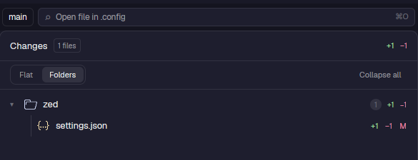

# ion-changes

Uncommitted changes of the folder you are working in, with side-by-side diffs and a commit box.



## What it does

- Lists changed files with `+/-` counts and their status, as a **flat** list or grouped by **folders** (Collapse all).
  It refreshes by watching the folder.
- **Diff:** open a file to get a side-by-side diff in Neovim (`git difftool` with `nvimdiff`) in a new tab, or in a popup
  over the current one. New untracked files open read-only. The Neovim setup (`diff.lua`, Catppuccin Mocha, no plugins)
  loads only for these diff tabs.
- **Commit box:** type a message and press Commit (or Enter): it runs `git add -A` then `git commit -m`. Failures are
  shown in place.
- Catppuccin Mocha file icons, shared with [`ion-files`](../ion-files).
- Git reads never write under `.git` (no index refresh, no lock), so the folder watch does not trigger itself.

## Why it exists

It is a clone of Herdr's `changes` mod (v0.1.12) reworked for daily use: diffs open in your editor instead of inline, a
folder view, icons and committing from the panel. Herdr overwrites its own mods on every start, so these edits live in a
clone.

## Where it is used

`layouts/piioni.json`: in the right-hand panel stack, between Files and PRs.

## Requirements

`git` and `nvim` on `PATH`.

## Files

| File | Role |
|---|---|
| `main.js` | The panel: list, views, commit box, diff launching |
| `hx.js` | Tab and popup helpers |
| `diff.lua` | Neovim setup for the diff tabs |
| `icons.js`, `changes.svg` | File icons and the panel icon |

## Check

```sh
herdr-app check mods/ion-changes
```
