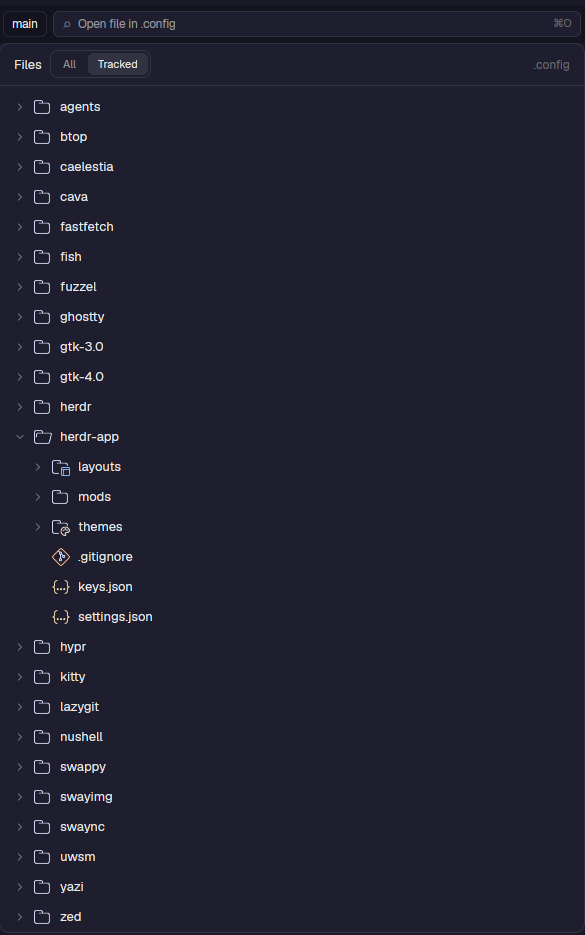

# ion-files

A file tree for the folder you are working in, with file operations and Helix one click away.



## What it does

- **Tree** of the focused space's folder; folders load when expanded. Toggle **Tracked** (git-tracked files only) or **All**.
- **Click a file** to open it in [Helix](https://helix-editor.com/) in a new tab (Shift-click: in a popup over the
  current tab). Click a folder to expand it.
- **Right-click menu:** Open in tab / popup, New file, New folder, Rename, Move to Trash, Reveal in Folder, Copy path,
  Copy relative path. Trashing asks first.
- **Small built-in editor** (Save / Discard) for quick edits. Saves compare against what was on disk when you opened the
  file, so an outside change is never overwritten silently.
- **Safe paths.** Everything is confined to the folder's root: names with `..`, backslashes or symlinks that escape are
  refused (`lib/paths.js`, covered by `test/confinement.test.mjs`).
- File and folder icons are [Catppuccin Mocha](https://github.com/catppuccin/vscode-icons) (MIT), in `icons/`.

## Why it exists

It is derived from Herdr's `files` mod (through [herdr-relevo](https://github.com/johnny4young/herdr-relevo)) and made
for working: create, rename, trash and edit without leaving the window, and jump straight into the editor you already
use.

## Where it is used

`layouts/piioni.json`: in the right-hand panel stack, next to Changes and PRs. The `relevo` file finder also opens files
through it (`props.role: "view"`).

## Requirements

- `hx` (Helix) on `PATH` for opening files.
- Linux: `gio trash` to trash and `xdg-open` to reveal. (macOS: `/usr/bin/trash` and Finder; handled in `lib/platform.js`.)

## Files

| File | Role |
|---|---|
| `main.js`, `view.js` | The tree and the single-file view |
| `actions.js` | The right-click menu, name prompt, trash confirmation |
| `editor.js`, `hx.js` | The built-in editor and the Helix tab/popup launchers |
| `lib/paths.js`, `lib/platform.js` | Path confinement and per-OS commands |
| `icons.js`, `icons/` | Icon lookup and the icon set |

## Tests

```sh
cd mods/ion-files && node --test test/*.test.mjs
herdr-app check mods/ion-files
```
