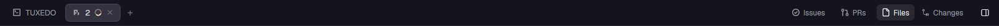

# ion-tabs

The tab bar, with the window buttons removed and the panel buttons moved next to the panel toggle.



## What it does

One mod, two blocks of the layout:

- **Tab bar** (center): the space's tabs, with the `+` button right after the last tab. No minimize/maximize/close buttons.
- **Panel buttons** (`props: {"panels": true}`, top right): **Files** and **Changes**, next to the show/hide panel
  toggle. Each one shows its panel in the right-hand stack. The **Issues** and **PRs** buttons beside them are drawn by
  the [`linear`](../linear) and [`prs`](../prs) mods themselves.

## Why it exists

It is a clone of Herdr's `tabs` mod (v0.1.12). The stock bar carries the window buttons and the Files/Changes buttons in
the same strip as the tabs; this one drops the window buttons and moves the panel buttons next to the panel toggle for a
cleaner top bar. Herdr overwrites its own mods on every start, so this lives in a clone.

## Where it is used

`layouts/piioni.json`, twice: once for the tab bar and once with `"panels": true`.

## Keeping it in sync

Clones are never updated by Herdr. If the stock `tabs` changes, copy it over and re-apply the two changes (search for
`panelsOnly`).

## Check

```sh
herdr-app check mods/ion-tabs
```
