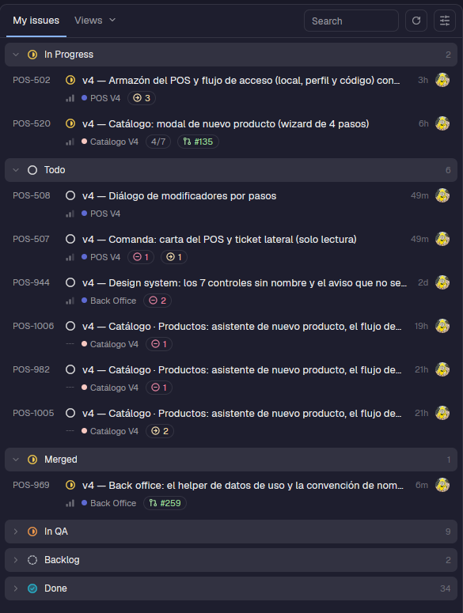

# linear

Your Linear tickets as a panel in Herdr.



## What it does

- Lists **My issues**, or any saved **View**, grouped by workflow state (In Progress, Todo, Merged, In QA, Backlog, Done);
  big groups fold and offer "Show N more".
- Each row: ticket id, title, project and label chips, how many open tickets block it or are blocked by it, the linked
  pull request (`#135`), age, and the assignee.
- Search box and display options. Each view remembers its own options (kept in a file shared with its popups).
- A click opens the ticket in your browser.

## Why it exists

It replaces the old GitHub Issues panel. The team plans in Linear, so what to work on next should be one click from the
terminal where the agent runs.

## Where it is used

`layouts/piioni.json`: a button in the top bar (`{"button": true}`) and the panel in the right-hand stack.

## Setup

The mod talks to Linear's GraphQL API with a personal API key. Create one (read access is enough) and store it in a file
only you can read:

```sh
input -s "Linear key: " | save -f ~/.config/linear/token   # nushell
chmod 600 ~/.config/linear/token
```

The panel shows this command (with a copy button) when the key is missing. The key is read from the file and sent in the
`Authorization` header; it is never put on a command line.

## Files

| File | Role |
|---|---|
| `main.js` | The panel and its popups |
| `api.js` | GraphQL queries and token reading |
| `model.js` | Pure logic: grouping, normalizing, blockers (unit tested) |
| `avatars.js`, `icons.js` | Avatar cache and icons |

## Tests

```sh
cd mods/linear && node --test test/*.test.mjs
herdr-app check mods/linear
```
