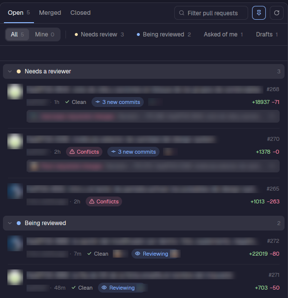

# prs

GitHub pull requests as a panel in Herdr, with a full PR dialog one click away.



*(Titles, users and avatars are blurred in the screenshot.)*

## What it does

- **Panel.** Lists the PRs of the repository you are working in under **Open / Merged / Closed**, with filter chips
  (All, Mine, Needs review, Being reviewed, Asked of me, Drafts) and a search box. Open PRs are grouped by what they need.
- **One glance per row.** Title, number, author, age, CI state, merge conflicts, new commits since you last looked,
  reviewers, the last feedback someone else left, and lines added and removed.
- **Review state that stays honest.** A review verdict only counts for the commit it reviewed: push new commits and the PR
  goes back to *needs review*.
- **Team convention.** "Assigned" means "being reviewed right now" (assign when you start reviewing, unassign when done),
  so assignees show up as a *Reviewing* capsule, not as an owner.
- **PR dialog (`viewer.js`).** Click a row: Conversation, Commits, Files and Checks tabs; a sidebar with reviewers,
  assignees, labels, checks and linked issues; a merge box; a review flow; a Linear chip; keyboard shortcuts; expandable
  checks; and a shortcut to open the PR in a worktree.

## Why it exists

The old Issues mod listed GitHub issues. The team works from Linear tickets and pull requests, so this panel answers the
daily question "which PRs need me, and which of mine are stuck?" without leaving the terminal.

## Where it is used

`layouts/piioni.json`: a button in the top bar (`{"button": true}`) and the panel itself in the right-hand stack.

## Requirements

- The [GitHub CLI](https://cli.github.com/) (`gh`), logged in. Every call goes through `gh`.
- Optional, for the Linear chip: a Linear API key in `~/.config/linear/token` (the same file the [`linear`](../linear) mod
  reads). The chip looks up the ticket id found in the branch name (`POS-941`); without the key it is simply not shown.

## Files

| File | Role |
|---|---|
| `main.js` | The panel: chips, groups, rows |
| `model.js` | Pure logic: statuses, grouping, last feedback, stale reviews (unit tested) |
| `viewer.js`, `timeline.js`, `sidebar.js`, `header.js`, `mergebox.js`, `merge.js`, `mergeload.js`, `actions.js` | The PR dialog |
| `people.js`, `pictures.js`, `icons.js`, `ui.js`, `menu.js`, `linear.js` | Avatars, icons, shared widgets, Linear link |

## Tests

```sh
cd mods/prs && node --test test/*.test.mjs
herdr-app check mods/prs
```
