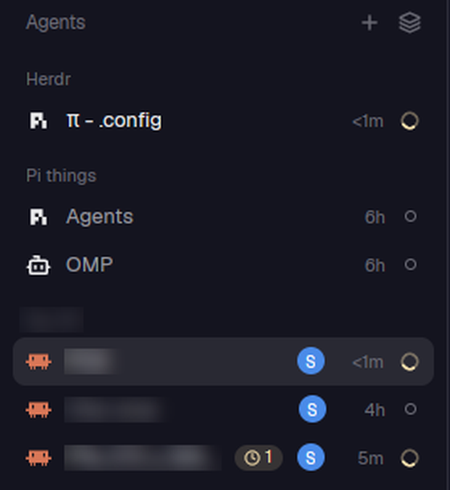

# relevo-agents

Herdr's **Agents** list, plus a launcher menu, the account each agent runs on and its background work.

*(Space and agent names of work projects are blurred in the screenshot.)*

## What it adds to the stock `agents` mod

Everything else (priority sections, grouping by space, pins, sub-agents, durations, sorting) is Herdr's own.

1. **`+` start-an-agent menu** in the header. Lists your launchers (Claude, Claude SIPOS, Pi, Pi SIPOS…); each one runs
   `relevo.launch-profile-<key>`. Codex is left out because it has its own account entry.
2. **Account circle.** A circle with the account's initial, in the account's color (the blue **S** above is Sipos).
   Hover the row and it becomes a **Move** button that continues the agent on another account (a
   [`relevo`](../relevo) handoff). Local agents only: a handoff reads and starts things on this computer.
3. **Background-work capsule.** A pulsing clock with a count (`⧗ 1` above) while the agent has shells or wakeups still
   running; the tooltip has the full text and you are notified when it finishes.

## Why it exists

With several accounts you need to see *which* one each agent is burning, and to move it before the limit hits. The circle
shows it at a glance, and the capsule tells a quiet agent that is waiting on a background task from an idle one.

## Requirements

- The [`relevo`](../relevo) mod: accounts and launchers come from its shared state (`relevo.setup`).
- For the circle and the capsule, the Claude Code hook in `../relevo/hooks/` (it sets the `agent.account` and `agent.bg`
  labels). Without it the list looks like the stock one, plus the `+` menu.

## Staying in sync with Herdr

Clones are never updated by Herdr. This one was rebuilt from the stock `agents` mod and the three additions re-applied.
To update it again: copy the stock `mods/agents/main.js` over, then re-apply the additions (search for `setup()`,
`accountTag`, `backgroundTag`, `launcherButton`, `launcherMenu`).

## Tests

Covered from the relevo suite: `cd mods/relevo && node --test test/agents.test.mjs`, then `herdr-app check mods/relevo-agents`.
