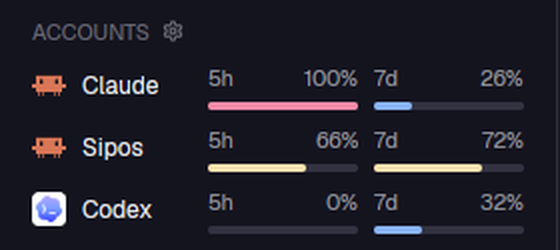
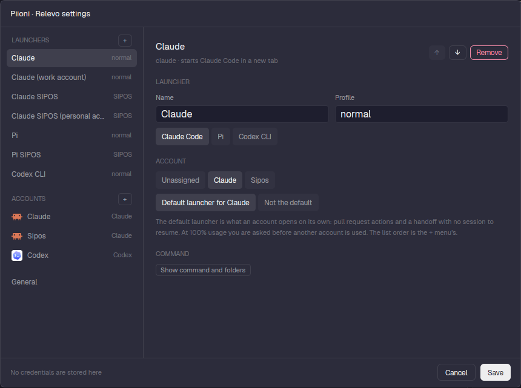

# relevo

Accounts, usage and agent launchers for Herdr. It is the core the other `relevo-*` pieces build on.





## What it does

One mod, several **roles** chosen with the block's `props.role` in the layout:

| Role | What you get |
|---|---|
| `accounts` | The sidebar block above: every account (Claude, Sipos, Codex) with its **5-hour and 7-day usage** bars and reset times. Click an account to refresh it, the gear opens Settings. Soft alerts at 80% and 95%, and when a background task finishes. |
| `panel-bar` | The strip on top of the right-hand panel: current branch, a file finder (`Open file in <repo>`, its shortcut shows next to the box) and a menu of that repo's checkouts. |
| `panel-toggle` | The button that shows or hides the right-hand panel. |
| `settings` | The Settings dialog (below). |
| `handoff` | Continue a running agent on **another account**: resumes the Claude session (or starts from a note) when you hit a limit. |
| `fallback` | When a launcher's account is at 100% it offers another account's launcher with the same profile. |
| `find-file`, `checkout-menu` | The popups behind the panel bar. |

It also answers `relevo.*` commands from `keys.json` (`relevo.next-waiting`, `relevo.handoff`, `relevo.settings`,
`relevo.launch-profile-<launcher>`, `relevo.panel-<name>`, `relevo.worktree-*`…).

## Why it exists

Working with several agents on several paid accounts, the useful questions are "how much do I have left on each?" and
"can this agent keep going on another account?". Relevo keeps that visible and one click away, instead of finding out
from an error message.

It started as a port of [herdr-relevo](https://github.com/johnny4young/herdr-relevo) to Linux, then lost everything this
setup does not use (Inbox, PR review, time ledger). PRs and tickets live in [`prs`](../prs) and [`linear`](../linear).

## Concepts

See [`GLOSSARY.md`](GLOSSARY.md): *account* (a provider identity with its own allowance), *launcher* (a named way to start
an app) and *profile* (an app's isolated configuration).

## Settings

Left rail: **Launchers**, **Accounts** and **General**, each with a `+`. Right side: the editor for the selected item.
Errors are marked per item and Save jumps to the first one. It writes `config.js` atomically; nothing else is touched and
no credentials are stored.

## Setup

- Edit `config.js` (or use Settings). `config.example.js` shows the shape.
- Optional **hook** `hooks/relevo-labels.py` for Claude Code (SessionStart, Stop, SessionEnd): it only sets terminal
  labels (`agent.account`, `agent.transcript`, `agent.wait`, `agent.bg`) that power the account circle and the
  background-work capsule in [`relevo-agents`](../relevo-agents) and handoffs. Runbook: [`hooks/HOOK.md`](hooks/HOOK.md).
- Claude usage comes from each account's own login (`.credentials.json` in its config folder); Codex from its auth file.
  Tokens stay in memory and are only sent as the provider's `Authorization` header.

## Files

| File | Role |
|---|---|
| `main.js` | Picks the role and routes `relevo.*` commands |
| `sidebar.js`, `alerts.js`, `quota.js` | Accounts block, usage collection, alerts |
| `accounts.js`, `lib/launchers.js`, `config.js` | Accounts, launchers and how a launcher becomes an argv |
| `settings.js`, `lib/settings.js` | The Settings dialog and its validation / atomic save |
| `handoff.js`, `lib/handoff.js`, `fallback.js` | Moving a session to another account |
| `panelbar.js`, `toolbar.js`, `worktrees.js` | Panel bar, file finder, checkouts |
| `bin/claude-token` | Runs Claude with another account's token from the keyring |

## Tests

```sh
cd mods/relevo
node --test 'test/*.test.mjs'
python3 test/hook_test.py
herdr-app check mods/relevo
```
