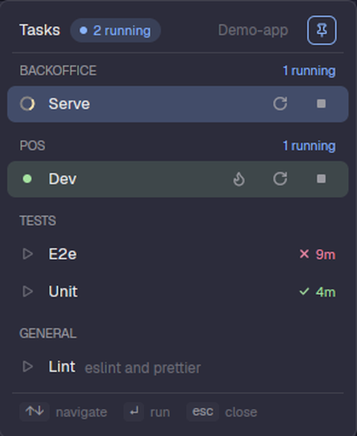

# tasks

Your project's dev servers, test runs and checks, one click from the terminal where the agent works.



## What it does

- A **Tasks** button in the top bar opens a popup with every script in `<repo>/.tasks/`, grouped by subfolder.
- A click starts the task **in the background**, as a sub-agent of an agent working in that worktree: it hangs under the
  agent in the agents panel and opens no tab. Click a running task to peek at its terminal (the peek has a *keep* button
  if you want it as a tab).
- Running tasks get **Restart** and **Stop**. A task that declares a reload key also gets, once it is up, a **Hot reload** button (and the
  `r` key in the popup) that sends that key to its terminal.
- The bar button **spins** while anything is compiling or reloading and turns **green** once everything running is up.
- When a task ends on its own you get a toast, a ✓ or ✗ with its age (kept for 24 hours) and a **Log** button with its last
  output.
- The popup follows the worktree of the tab you are in. A selector in the header switches worktree, and the pin keeps one
  on screen whatever the focus.
- Keys: `↑` `↓` select, `Enter` runs (or peeks), `r` reloads the selected task when it can, `Esc` closes.

## Why it exists

It replaces running dev servers and test commands from the editor's task runner. Tasks live next to the code as plain
shell scripts, work the same in every worktree, and report their state back where you already look.

## Where it is used

`layouts/piioni.json`: the `tasks-button` block, with `{"button": true}`. The popup is the same mod opened as an overlay.

## Defining tasks

```
<repo>/.tasks/
  backoffice/dev.sh        a group: one per subfolder
  tests/unit.sh
  lint.sh                  loose scripts are listed under "General"
  .lib/helpers.sh          hidden folders are skipped: shared code goes here
```

Each `.sh` file runs with `bash`, from the root of the worktree. Groups are ordered `backoffice`, `pos`, `tests` (the
`ORDER` list in `main.js`), then the rest alphabetically, then "General". `.tasks` is usually git-ignored, so a worktree
that has none uses the main checkout's.

Optional header lines, in the first eight lines of the script:

| Line | Meaning |
|---|---|
| `# name: Lint · eslint and prettier` | Display name. Anything after ` · ` is shown muted. Defaults to the file name. |
| `# ready: Flutter run key commands` | Regex (case-insensitive, per line). The task counts as up once its screen matches it. |
| `# reload: r` | Key sent to the terminal by the Hot reload button. |
| `# busy: Performing hot reload\.\.\.[^0-9\n]*$` | Regex that matches only while a reload is in progress, so the button spins until it stops matching. |

A `# ready:` or `# busy:` that is not a valid regex is ignored, with a warning when the task starts. Without `# ready:` a
task simply counts as busy while it runs, which is right for tests and builds.

```bash
#!/usr/bin/env bash
# name: dev
# ready: Flutter run key commands
# reload: r
# busy: (Performing hot (reload|restart)|(Re)?compiling)[^\n]*\.\.\.[^0-9\n]*$
cd "$(git rev-parse --show-toplevel)/apps/web" || exit 1
exec fvm flutter run -d chrome --web-port=5500
```

## How it works

- A task starts with `hc run --bg --outlive-parent --no-notify --name <n> --label herdr.task=<repo>:<file> [--label
  herdr.ready=<regex>] --parent <agent> -- bash <script>`. The `herdr.task` label is how a running task is recognised.
- The agent it hangs from is one working in the task's worktree (the focused one first), else the focused one, else one in
  the tab or the space. With no agent around the task still runs and a notice says so.
- The bar button copy (always alive) watches the labels. While a task has a `# ready:` it has not matched, or a reload is in
  progress, it reads that terminal's screen every 3 s (0.5 s while reloading). With nothing to wait for there is no timer.
- Which worktree: the focused terminal's folder, else the tab's agent, else any terminal in the tab, else the space's
  folder. A worktree picked in the selector is remembered per tab; a pinned one wins over the focus. If the pinned
  worktree is gone, the pin is dropped with a notice.
- State shared between the popup and the button lives in `shared.json`: `tasks.last`, `tasks.ready`, `tasks.busy`,
  `tasks.pinned`, `tasks.worktree`.

## Limits

- Local machine only. In a space on another machine the popup says so.
- The mod's `fs` can only read inside your home folder, so a repo outside it lists no tasks.
- Only lowercase keys are covered: in testing `hc keys` delivered `R` as `r`, so hot restart is not available.
- A finished task leaves no shell behind. Its output is available through **Log** while the core still keeps the terminal.
- Reload detection depends on the tool's wording; if it differs, the button spins for under a second instead of for the
  whole reload.

## Files

| File | Role |
|---|---|
| `main.js` | The popup, the bar button, running and polling tasks |
| `model.js` | Pure logic: worktree and header parsing, regex compile, failure text (unit tested) |
| `play.svg` `restart.svg` `stop.svg` `reload.svg` `check.svg` `x.svg` `log.svg` `pin.svg` | Icons |
| `test/model.test.mjs` | Tests for `model.js` |

## Tests

```sh
cd mods/tasks && node --test test/*.test.mjs
herdr-app check mods/tasks
```
